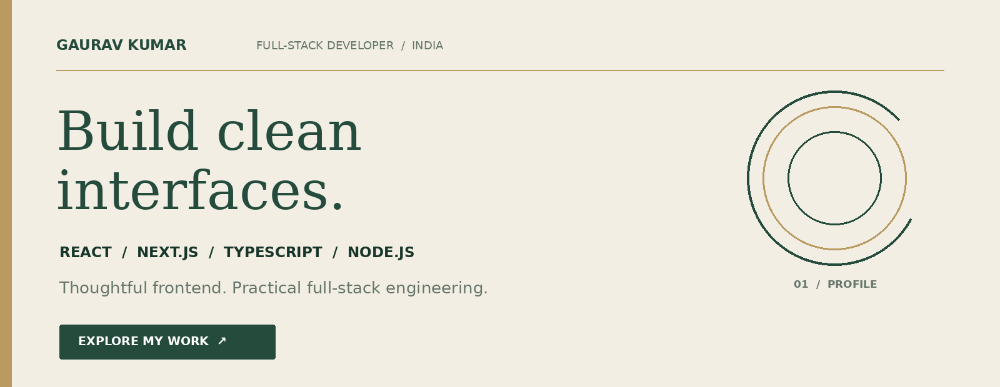
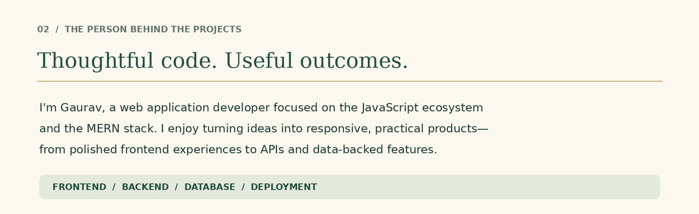
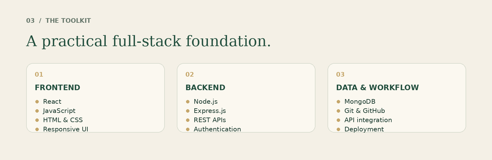
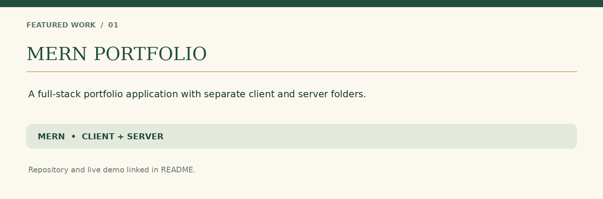
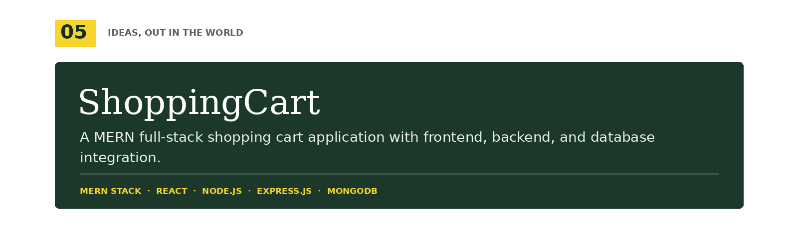
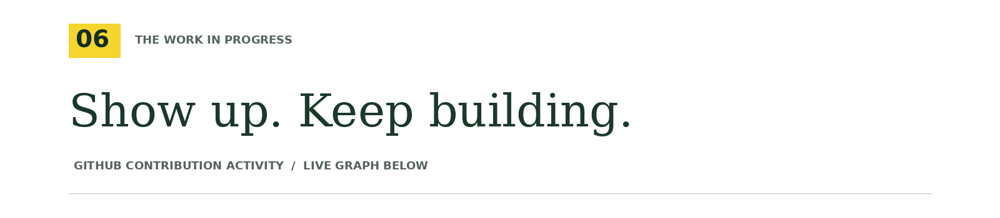

  

  

  

  

  

  

  

  <a href="https://www.linkedin.com/in/gaurav-pure2/">LinkedIn</a> ·
  <a href="https://mern-portfolio-3hfs.vercel.app/">Portfolio</a> ·
  <a href="https://github.com/gauravsof05-arch">GitHub</a>

<i>Explore. Build. Share. Repeat.</i>

